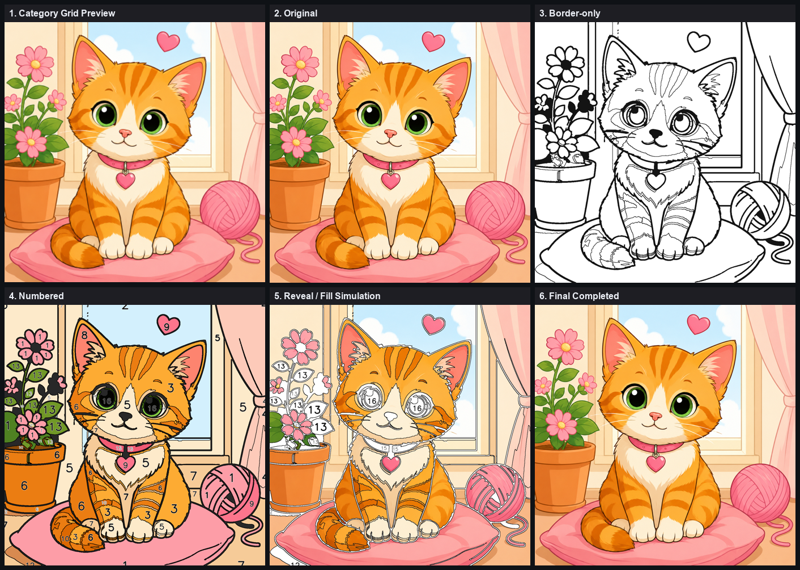

# Admin Publishing Flow — Report

**Goal.** The owner/admin workflow that prepares an image before it appears in the user app.
**Users never upload** — only an admin uploads colour images, and each image must be
**reviewed and approved** before it is **published** and becomes available to users.

This sprint is purely admin workflow + publishing metadata. It changes **no image algorithm,
no reveal mode, and no border engine** — it reads the existing pipeline / review outputs and
adds a lifecycle, a package manifest, and a catalog.

---

## Publish lifecycle

A per-job `publish.json` tracks one of six states; `publishing.py` owns the transitions.

```
draft ─▶ processing ─▶ review ─▶ approved ─▶ published
                          │           │
                          ├──▶ rejected◀──┘
                          ▼
                     (regenerate ⟳ processing)      published ─▶ approved  (unpublish)
```

| State | Meaning | Set by |
|-------|---------|--------|
| **draft** | admin uploaded the colour image; not processed | `POST /api/admin/upload` |
| **processing** | the pipeline is running | `POST /api/process` + `pipeline.run` start |
| **review** | processed; awaiting the admin decision | `pipeline.run` end (after review build) |
| **approved** | admin approved; ready to publish | `POST …/review/approve` |
| **rejected** | admin rejected (with reason) | `POST …/review/reject` |
| **published** | packaged and exposed to users | `POST …/publish/publish` |

Transitions are validated (illegal jumps are refused); the automatic states
(`processing`, `review`) are force-set by best-effort pipeline hooks so a **Regenerate**
cleanly resets an already-approved image back through the lifecycle. `approved → published`
happens **only** through `publish()`, which assembles and verifies the package first.

---

## Admin review view

The admin dashboard (`GET /api/admin/publishing/page`) lists every image with its status and,
per image, shows the required review surface:

1. **Category grid preview** (the thumbnail)  2. **Original**  3. **Border-only**
4. **Numbered coloring**  5. **Reveal / fill simulation**  6. **Final completed**
7. **Quality stats** (from the Admin Review System)  8. **Approve / Reject / Regenerate**
(plus **Publish / Unpublish** and a category editor).



*The six visual previews for the test cat, exactly as the admin sees them.*

---

## Approved image package

Publishing assembles and **verifies** a package (write to `publish_manifest.json`); publish is
refused unless the status is `approved` **and** every required component is present.

| Component | Files |
|-----------|-------|
| original image | `original.png` |
| border image | `outline.svg` (+ `review_border_preview.png`) |
| numbered image | `game_preview.png` |
| labels / regions | `labels.npy`, `regions.json` |
| palette / navigation colours | `palette.json` |
| reveal masks | `reveal_master.png`, `region_mask.png`, `labels.npy` (+ blank/partial/highlight/completed) |
| game_config | `game_config.json` |
| category metadata | category `{name, title, tags}` from `publish.json` |
| thumbnail / grid preview | `publish_thumbnail.png` (generated at publish) |

---

## Catalog (what users see)

`GET /api/catalog` returns **only published** images, grouped by category with their thumbnail
and brief stats — the category grid users browse (`GET /api/catalog/page`). Unpublished,
draft, in-review, and rejected images are never exposed to users.

---

## API surface

| Method + endpoint | Purpose |
|-------------------|---------|
| `POST /api/admin/upload` | admin upload (file + category + title) → `draft` |
| `POST /api/process` | run the pipeline → `processing` (→ `review` on finish) |
| `GET /api/job/{id}/publish` | publish status + category + package manifest |
| `PUT /api/job/{id}/publish/category` | set category `{name, title, tags}` |
| `POST /api/job/{id}/review/approve` \| `…/reject` | admin decision → `approved` / `rejected` |
| `POST /api/job/{id}/review/regenerate` | reprocess → back to `processing` |
| `POST /api/job/{id}/publish/publish` | `approved` → `published` (assembles + verifies package) |
| `POST /api/job/{id}/publish/unpublish` | `published` → `approved` |
| `GET /api/job/{id}/publish/asset/{name}` | serve a whitelisted publishing/catalog asset |
| `GET /api/catalog` · `GET /api/catalog/page` | user-facing catalog (published only) |
| `GET /api/admin/publishing` · `…/page` | admin dashboard (all states) |

The review approve/reject also advance the publish lifecycle, so the Admin Review System and
the publishing status stay in sync. Two self-contained pages (admin dashboard + user catalog)
ship as vanilla HTML — no frontend build step.

---

## Constraints honoured

- **No image algorithm change** — publishing reads pipeline outputs; it never re-runs
  detection, segmentation, palette, or numbering.
- **No reveal-mode change** — reveal assets are packaged as-is.
- **No border-engine change** — the border image is the existing `outline.svg`.
- Only `publish.json`, `publish_manifest.json`, and `publish_thumbnail.png` are written.

---

## End-to-end test — the existing cat image

`cat.png` was driven through the whole flow (deterministic line art):

```
1) ADMIN UPLOAD  -> draft   (category "cats" / "Curious Cat")
2) PROCESS       -> review  (job done, review.json built)
3) APPROVE       -> approved
4) PUBLISH       -> published   package complete: True  (9/9 components)
5) CATALOG       -> visible: 94 regions, 22 colours, difficulty hard, thumbnail present
6) HISTORY       -> draft -> processing -> review -> approved -> published
7) UNPUBLISH     -> approved  (catalog empties)  ->  re-PUBLISH -> published
```

All nine package components verified present; the whitelisted asset endpoint serves the
package/thumbnail and refuses anything else (e.g. `publish.json` → 404). The generated
`publish_manifest.json` and thumbnail are checked in beside this report.

---

## Files

- `backend/services/publishing.py` — lifecycle state machine, category metadata, thumbnail,
  package manifest + verification, publish/unpublish, catalog/dashboard.
- `backend/pipeline.py` — `_set_publish` hooks (`processing` at start, `review` after the
  review build) in `run()` + `reprocess()`.
- `backend/main.py` — admin upload, publish/category/publish/unpublish/asset endpoints,
  catalog + admin dashboard endpoints, and the two self-contained pages; review approve/reject
  bridged to the publish lifecycle.
- Test + visuals: `research/08_reports/admin_publishing/` (`test_publish_cat.py`,
  `cat_publish_manifest.json`, `cat_publish.json`, `publishing_previews_cat.png`,
  `cat_thumbnail.png`, `make_publish_board.py`).

## Verdict

Every image now flows draft → processing → review → approved → published under admin control,
with a verified approved-image package and a user catalog that exposes only published images.
No image algorithm, reveal mode, or border engine was touched — this is admin workflow and
publishing metadata only. Requirements met in full.
