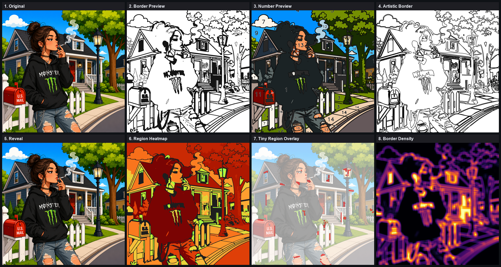

# Admin Review System — Report

**Goal.** A complete review layer that sits between processing and approval. For every
uploaded image it builds eight review previews, ten headline statistics, and four one-click
actions into `review.json` — and it is **strictly read-only** over the pipeline: it creates
only review assets, and modifies no rendering, no regions, no palette, no numbers, no reveal.

---

## Architecture

A new service, `backend/services/review_engine.py`, runs as a best-effort final pass
(`pipeline._apply_review`, after `finish_job` in both `run()` and `reprocess()`). It **reads**
`labels.npy`, `game_config.json`, `outline.svg`, the palette and the brain reports; it
**writes** only `review_*` assets and `review.json`. Because it runs after everything else and
never writes a core artifact, it cannot alter the result — proven below by a byte-hash check.

The API (`backend/main.py`) exposes the review and its four actions; a self-contained admin
page (`GET …/review/page`) renders the previews, statistics and buttons with no frontend
build step.

---

## The eight previews

| # | Preview | Source | What it shows |
|---|---------|--------|---------------|
| 1 | Original Image | `original.png` | the upload as processed |
| 2 | Border Preview | generated | plain region boundaries (the line-art the player fills) |
| 3 | Number Preview | `game_preview.png` | the numbered colour-by-number |
| 4 | Artistic Border Preview | rasterised `outline.svg` | the semantic render — thickened silhouettes, emphasised features, removed noise |
| 5 | Reveal Preview | `reveal_completed.png` | the completed reveal (equals the original) |
| 6 | Region Heatmap | generated | every region tinted by area (log-scaled) — spot over-large or over-small regions |
| 7 | Tiny Region Overlay | generated | sub-threshold regions flagged in red over the faded art |
| 8 | Border Density Map | generated | local border busyness (box-blurred boundary map) — spot cluttered zones |

The three novel maps (6–8) are computed directly from the region labels; previews 1/3/5
reference existing pipeline assets, and 2/4 are rendered read-only from labels / `outline.svg`.

*The eight previews for one job (img 14). Panel 7 flags tiny detail regions in red; panel 8
runs hot where borders are busiest (porch, mailbox, railings).*

---

## The ten statistics

| Statistic | Definition |
|-----------|------------|
| Region count | number of regions in `game_config` |
| Palette count | number of palette colours |
| Tiny regions | regions below `max(64px, 0.0004·W·H)` (threshold reported in `review.json`) |
| Largest region | biggest region, as px and % of frame |
| Average region size | mean region area (px) |
| Estimated difficulty | the profile difficulty carried in `game_config` |
| Estimated play time | Σ per region of `find (5s) + fill (area/3000, clamped 2–30s)`, in minutes |
| Complexity score | 0–100: `0.5·region + 0.35·border-density + 0.15·tiny-fraction` (each capped) |
| Border quality score | 0–100 from `border_quality_report`: penalises leaks, failed passes, jaggedness, fragments |
| Artistic score | 0–100: mean of the artistic-border engine's visual / enjoyment / structural / artistic / playability scores |

The three composite scores (complexity, border-quality, artistic) are explainable 0–100
triage indices for ranking a batch, not ground truth; all inputs are pipeline measurements,
never re-detected here.

---

## One-click actions

Declared in `review.json` and served by the API:

| Action | Method / endpoint | Effect |
|--------|-------------------|--------|
| **Approve** | `POST …/review/approve` | sets `status = approved` in `review.json` |
| **Reject** | `POST …/review/reject` `{reason?}` | sets `status = rejected` (+ reason) |
| **Regenerate** | `POST …/review/regenerate` | snapshots the current review → `review_previous.json`, then reprocesses; the review rebuilds automatically on completion |
| **Compare Previous Version** | `GET …/review/compare` | diffs the current statistics against the archived previous version |

Supporting endpoints: `GET …/review` (build-on-demand + fetch), `POST …/review/rebuild`,
`GET …/review/asset/{name}` (serves a preview; whitelisted to the filenames in `review.json`
so it cannot read arbitrary files), `GET …/review/page` (the admin UI).

`review.json` carries: `status`, `decision`, `assets` (the 8), `statistics` (the 10),
`actions` (the 4), and `comparison` (deltas vs the previous version).

---

## Validation — all 27 images

`build_review` was run over the 27 finished job dirs, and a fresh wired pipeline run
confirmed the pass fires automatically.

| Check | Result |
|-------|--------|
| Read-only (sha1 of `game_config`, `outline.svg`, `labels.npy`, `palette`, `regions`, reveal, number preview identical before/after) | **27 / 27** |
| All eight previews present as real files | **27 / 27** |
| All ten statistics present and non-null | **27 / 27** |
| Crashes | **0** |
| Wired pipeline run auto-emits `review.json` (8 assets, status `pending`) | **yes** |

The read-only result is the key one: building the review provably changes none of the
pipeline's outputs — it only adds review assets, exactly as required.

### Per-image statistics

| # | Regions | Palette | Tiny | Largest % | Avg px | Difficulty | Play | Complexity | Border Q | Artistic |
|---|--------:|--------:|-----:|----------:|-------:|:----------:|-----:|-----------:|---------:|---------:|
| 1 | 80 | 27 | 3 | 9.11 | 12292 | hard | 12m | 55 | 69 | 32 |
| 2 | 105 | 32 | 13 | 14.82 | 9041 | hard | 15m | 64 | 73 | 33 |
| 3 | 73 | 22 | 11 | 33.91 | 9375 | hard | 9m | 57 | 75 | 36 |
| 4 | 46 | 28 | 5 | 54.08 | 27779 | hard | 6m | 50 | 68 | 25 |
| 5 | 40 | 16 | 1 | 17.15 | 24793 | medium | 8m | 45 | 69 | 30 |
| 6 | 28 | 10 | 2 | 59.67 | 52373 | medium | 4m | 32 | 77 | 39 |
| 7 | 75 | 31 | 27 | 40.00 | 17476 | hard | 10m | 66 | 68 | 21 |
| 8 | 6 | 6 | 2 | 39.66 | 256986 | easy | 2m | 21 | 76 | 16 |
| 9 | 16 | 9 | 3 | 53.94 | 93781 | medium | 3m | 28 | 72 | 34 |
| 10 | 30 | 12 | 10 | 43.29 | 49618 | medium | 5m | 39 | 73 | 26 |
| 11 | 8 | 6 | 1 | 44.93 | 189234 | easy | 2m | 20 | 75 | 17 |
| 12 | 6 | 6 | 2 | 37.42 | 258461 | easy | 2m | 20 | 75 | 31 |
| 13 | 50 | 27 | 12 | 25.10 | 29333 | hard | 9m | 47 | 78 | 34 |
| 14 | 153 | 37 | 26 | 21.45 | 8288 | hard | 21m | 76 | 74 | 34 |
| 15 | 68 | 17 | 0 | 19.32 | 16513 | medium | 11m | 50 | 75 | 40 |
| 16 | 86 | 30 | 9 | 32.57 | 14327 | hard | 12m | 58 | 72 | 36 |
| 17 | 55 | 24 | 1 | 26.72 | 17206 | hard | 8m | 48 | 72 | 30 |
| 18 | 44 | 15 | 0 | 20.04 | 19026 | medium | 7m | 45 | 72 | 25 |
| 19 | 64 | 30 | 18 | 19.14 | 21452 | hard | 12m | 60 | 71 | 25 |
| 20 | 68 | 16 | 2 | 23.12 | 16702 | medium | 9m | 52 | 72 | 33 |
| 21 | 47 | 17 | 0 | 21.22 | 19643 | medium | 8m | 46 | 75 | 38 |
| 22 | 18 | 10 | 7 | 40.76 | 85030 | medium | 4m | 31 | 80 | 16 |
| 23 | 23 | 16 | 1 | 17.52 | 64434 | medium | 8m | 42 | 83 | 38 |
| 24 | 18 | 14 | 3 | 17.24 | 84184 | medium | 7m | 36 | 80 | 40 |
| 25 | 67 | 25 | 13 | 16.77 | 22053 | hard | 12m | 48 | 78 | 38 |
| 26 | 82 | 35 | 13 | 16.07 | 17538 | hard | 14m | 57 | 77 | 35 |
| 27 | 105 | 26 | 8 | 9.00 | 13524 | hard | 18m | 62 | 79 | 48 |

---

## Files

- `backend/services/review_engine.py` — the review builder (8 assets, 10 stats, actions,
  status, compare); `set_status`, `archive_current`, `compare_previous`.
- `backend/pipeline.py` — `_apply_review`, called after `finish_job` in `run()` + `reprocess()`.
- `backend/main.py` — review endpoints (get / rebuild / approve / reject / regenerate /
  compare / asset / page) + the self-contained admin page.
- Validation: `research/08_reports/admin_review/review_validation.json`; visuals
  `review_board_14.png`, `review_board_27.png`; harness `batch_review.py`, `make_review_board.py`.

## Verdict

Every uploaded image now has a full review layer — eight previews, ten statistics, four
one-click actions in `review.json`, plus an admin page to drive them. The layer is provably
read-only (27/27, byte-hash verified): it creates only review assets and touches nothing the
player will see. Requirements met in full.
