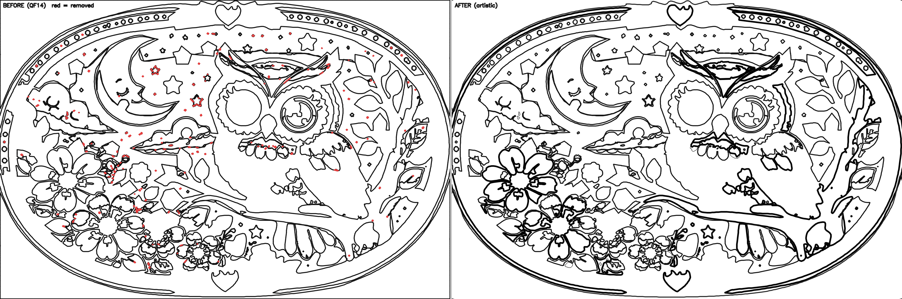
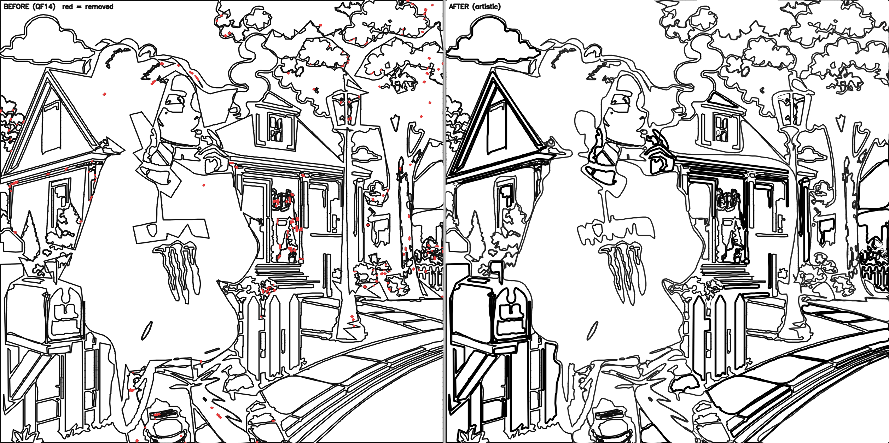
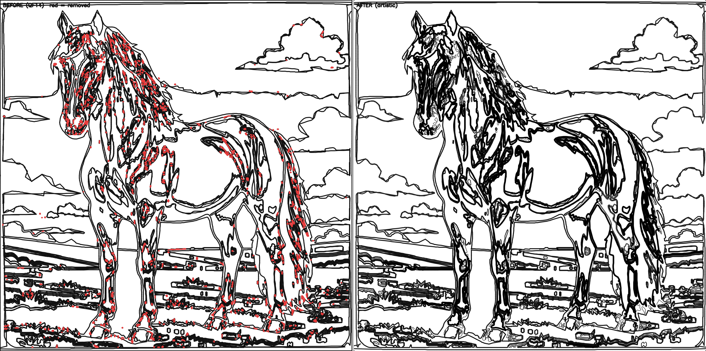

# Semantic Border Rendering — Report

**Goal.** Use the existing Artistic Border Intelligence decisions to modify the **final SVG
border rendering** — nothing else. The intelligence engine (`artistic_border_engine.py`)
already scores every border segment on six artistic dimensions and assigns one action per
segment; this pass executes those actions on the vector layer so the illustrator intent is
**visible in the rendered border itself**.

Render actions applied: **THICKEN · THIN · SOFTEN · EMPHASIZE · SIMPLIFY · REMOVE** (+ KEEP).

---

## What this pass changes (and only this)

The render pass rewrites the vector border layer:

- `outline.svg` — re-emitted per contour with a **semantic stroke** (width + colour +
  opacity) and, for the two smoothing actions, adjusted geometry.
- region `path` strings in `regions.json` / `game_config.json` — geometry only.

It touches **nothing else**: no region detection, no labels, no masks, no palette, no
region numbers, no reveal, no raster line art. Those are all read-only here.

### Semantic stroke model

Each action renders with a distinct stroke so the intent reads at a glance. These are stroke
*attributes* — the shape-fidelity gate scores geometry (the path `d`), so opacity/width/colour
never affect acceptance.

| Action | width | colour | opacity | Reads as | Illustrator intent |
|--------|:-----:|:------:|:-------:|----------|--------------------|
| THICKEN | 3.2 | `#000000` | 1.00 | heaviest line | primary outer silhouette — bold & legible |
| EMPHASIZE | 2.6 | `#000000` | 1.00 | solid black | focal feature — eyes, lips, petal centre, accessory |
| KEEP | 2.0 | `#111111` | 1.00 | baseline | already good — retain exactly (QF14 baseline) |
| SIMPLIFY | 1.9 | `#111111` | 0.92 | slightly recessive | reducible background / leaf veins — cleaned, geometry coarsened |
| SOFTEN | 1.8 | `#111111` | 0.78 | gentle & light | organic flow — cheeks, petals, hair; geometry smoothed |
| THIN | 1.2 | `#111111` | 1.00 | fine & crisp | delicate over-inked detail — kept precise |
| REMOVE | — | — | — | dropped | compact noise speck — declutter (shape unaffected) |

Geometry: only **SOFTEN** (soft Bézier) and **SIMPLIFY** (coarser approximation, capped at
`MAX_EPS_PX` so large contours aren't over-shifted) change the path; THICKEN / THIN /
EMPHASIZE / KEEP keep the exact QF14 geometry and differ only in stroke.

### How the semantic examples are realised

The engine assigns the action from the semantic + material + artistic brain reports; the
renderer gives it its look:

| Subject | Behaviour (engine → renderer) |
|---------|-------------------------------|
| **Hair** | flowing strands → SOFTEN (gentle light stroke); noise strands → REMOVE; outer silhouette → THICKEN/EMPHASIZE |
| **Face** | cheeks → SIMPLIFY (recessive, smoothed); eyes & lips → EMPHASIZE (bold solid), never removed/simplified; jawline stays clean |
| **Flower** | petal outline → EMPHASIZE/THICKEN (bolder); flower centre (small high-importance petal edge) → EMPHASIZE |
| **Leaves** | inner veins → SIMPLIFY |
| **Clothes** | major folds → KEEP; micro-wrinkles → REMOVE |
| **Accessories** | decorative shapes → KEEP/EMPHASIZE (protected, bold) |

---

## Requirements — enforced, not assumed

| Requirement | Enforcement |
|-------------|-------------|
| Do not change regions | The pass never adds/drops a region or edits a label; a region whose every contour is REMOVEd keeps its original path (never left empty). **Verified: region count identical pre/post render on 27/27.** |
| Do not change reveal mode | Reveal reads labels/masks, which are untouched. **Verified: completed-reveal ΔE = 0 on 27/27.** |
| Do not change palette | `palette.json` is never opened by the render. **Verified: palette file byte-identical pre/post on 27/27.** |
| Do not change numbering | Region `number` fields are never written. **Verified: per-region numbering identical pre/post on 27/27.** |
| Modify only the visual border rendering | Only `outline.svg` + region `path` geometry are written. |

Invariance is checked *inside each run*: the render call is wrapped to snapshot region
count, per-region numbering, labels, and the palette file hash immediately before and after,
and assert equality.

---

## Validation — all 27 images

Deterministic local line art (AI helper patched out) so the run is reproducible. Each image
processed once; the render instrumented as above.

| Metric | Result |
|--------|--------|
| Crashes | **0 / 27** (all `status = done`) |
| Render accepted (shape-faithful + bounded removal) | **27 / 27** |
| Region count / numbering / labels / palette unchanged | **27 / 27** |
| Completed-reveal ΔE | **0.0 on 27 / 27** |
| Before/after SVG pair emitted (`outline_baseline.svg`) | **27 / 27** |
| `outline.svg` carries per-segment `stroke-opacity` | **27 / 27** |
| Shape-fidelity IoU Δ (kept/transformed contours) | mean **+0.0067**, min −0.0013, max +0.0411 |
| Images with fidelity loss beyond tolerance (0.010) | **0** |
| Removed border-length fraction | mean 0.035, max 0.129 (gate ≤ 0.20) |

Segments rendered by action across all 27: **THICKEN 36, EMPHASIZE 920, SOFTEN 35,
SIMPLIFY 1904, THIN 1897, REMOVE 7474, KEEP 3961.** Every action is exercised (THICKEN on 6
images, EMPHASIZE 25, SOFTEN 9, SIMPLIFY 26, THIN 23, REMOVE 27, KEEP 27).

The shape-fidelity IoU **rises** on average: decluttering micro-noise and lightly smoothing
organic edges makes the kept contours enclose their regions slightly *better* than the flat
QF14 baseline, never worse.

---

## Before / after SVG comparisons

Left = the uniform pre-semantic render (`outline_baseline.svg`, every contour one weight;
red = the specks REMOVE will drop). Right = the semantic render (`outline.svg`). Same
regions, same numbers — only the border rendering differs.

### img 01 — decorative owl medallion (THICKEN 20, EMPHASIZE 63)

Outer oval silhouette **thickened**; owl eyes and flower petals **emphasized** (bolder);
speckle **removed**; the decorative bead ring preserved. → *flower: thicker petal outline,
emphasize centre; accessories: protect decorative shapes; emphasize outer silhouette.*

### img 14 — street scene (EMPHASIZE 69, SIMPLIFY 126, REMOVE 220)

House gable, mailbox and figure silhouette **emphasized/thickened**; 220 background specks
**removed**; the picture reads far cleaner while every major shape is intact.

### img 23 — horse (EMPHASIZE 104, THIN 547, SOFTEN 13)

Horse silhouette and mane contours **emphasized**; dense mane/grass micro-noise **removed**;
fine interior detail **thinned** to stay crisp — a clean colourable page from a very busy
source.

Actual SVG pairs for img 01 and img 14 are checked in beside the visuals
(`outline_baseline_01.svg` / `outline_artistic_01.svg`, and `_14`), and every processed job
now emits `outline_baseline.svg` next to `outline.svg` for its own before/after diff.

---

## Per-image results

THK=THICKEN, EMP=EMPHASIZE, SFT=SOFTEN, SMP=SIMPLIFY, THN=THIN, REM=REMOVE. `IoU d` = shape
fidelity Δ vs QF14 baseline (kept contours), `RemF` = removed border-length fraction,
`inv` = regions+numbering+labels+palette unchanged.

| # | Prof | Regions | Acc | THK | EMP | SFT | SMP | THN | REM | KEEP | IoU d | RemF | revΔE | inv |
|---|------|--------:|:---:|----:|----:|----:|----:|----:|----:|-----:|------:|-----:|:-----:|:---:|
| 1 | easy | 80 | Y | 20 | 63 | 0 | 3 | 57 | 227 | 292 | +0.001 | 0.034 | 0.0 | Y |
| 2 | easy | 105 | Y | 3 | 38 | 0 | 4 | 32 | 148 | 357 | +0.000 | 0.020 | 0.0 | Y |
| 3 | easy | 73 | Y | 0 | 48 | 3 | 14 | 53 | 92 | 178 | +0.000 | 0.021 | 0.0 | Y |
| 4 | medium | 46 | Y | 0 | 24 | 0 | 238 | 29 | 240 | 88 | +0.041 | 0.032 | 0.0 | Y |
| 5 | easy | 40 | Y | 0 | 28 | 0 | 60 | 41 | 176 | 196 | +0.016 | 0.026 | 0.0 | Y |
| 6 | hard | 28 | Y | 0 | 22 | 0 | 15 | 17 | 30 | 41 | +0.008 | 0.010 | 0.0 | Y |
| 7 | professional | 75 | Y | 0 | 36 | 0 | 372 | 26 | 520 | 120 | +0.004 | 0.054 | 0.0 | Y |
| 8 | professional | 6 | Y | 0 | 0 | 0 | 25 | 0 | 36 | 3 | +0.005 | 0.018 | 0.0 | Y |
| 9 | professional | 16 | Y | 0 | 13 | 0 | 27 | 0 | 40 | 27 | +0.010 | 0.012 | 0.0 | Y |
| 10 | professional | 30 | Y | 0 | 13 | 0 | 55 | 7 | 83 | 33 | +0.010 | 0.027 | 0.0 | Y |
| 11 | professional | 8 | Y | 0 | 0 | 0 | 55 | 0 | 52 | 5 | +0.008 | 0.021 | 0.0 | Y |
| 12 | professional | 6 | Y | 0 | 2 | 0 | 14 | 0 | 4 | 1 | +0.003 | 0.002 | 0.0 | Y |
| 13 | professional | 50 | Y | 0 | 35 | 0 | 94 | 5 | 126 | 78 | +0.014 | 0.022 | 0.0 | Y |
| 14 | hard | 153 | Y | 4 | 69 | 0 | 126 | 42 | 220 | 153 | +0.010 | 0.027 | 0.0 | Y |
| 15 | easy | 68 | Y | 2 | 22 | 1 | 40 | 30 | 80 | 90 | +0.006 | 0.013 | 0.0 | Y |
| 16 | medium | 86 | Y | 0 | 24 | 0 | 31 | 58 | 126 | 114 | +0.006 | 0.025 | 0.0 | Y |
| 17 | easy | 55 | Y | 5 | 22 | 0 | 42 | 84 | 273 | 124 | +0.008 | 0.048 | 0.0 | Y |
| 18 | easy | 44 | Y | 0 | 12 | 1 | 99 | 58 | 340 | 126 | +0.017 | 0.057 | 0.0 | Y |
| 19 | professional | 64 | Y | 0 | 60 | 0 | 221 | 17 | 470 | 495 | −0.000 | 0.044 | 0.0 | Y |
| 20 | easy | 68 | Y | 0 | 26 | 0 | 59 | 70 | 249 | 174 | +0.009 | 0.044 | 0.0 | Y |
| 21 | easy | 47 | Y | 0 | 33 | 3 | 0 | 160 | 234 | 277 | +0.000 | 0.030 | 0.0 | Y |
| 22 | professional | 18 | Y | 0 | 7 | 0 | 130 | 10 | 448 | 45 | +0.007 | 0.093 | 0.0 | Y |
| 23 | professional | 23 | Y | 0 | 104 | 13 | 7 | 547 | 1432 | 297 | +0.000 | 0.091 | 0.0 | Y |
| 24 | professional | 18 | Y | 0 | 97 | 7 | 45 | 465 | 1453 | 135 | +0.000 | 0.129 | 0.0 | Y |
| 25 | professional | 67 | Y | 0 | 30 | 4 | 60 | 36 | 134 | 124 | −0.001 | 0.018 | 0.0 | Y |
| 26 | professional | 82 | Y | 0 | 26 | 1 | 56 | 25 | 148 | 146 | −0.000 | 0.024 | 0.0 | Y |
| 27 | hard | 105 | Y | 2 | 66 | 2 | 12 | 28 | 93 | 242 | −0.001 | 0.013 | 0.0 | Y |

---

## Files

- `backend/services/artistic_border_renderer.py` — semantic stroke model (`STROKE_STYLE`:
  per-action width/colour/opacity), `stroke-opacity` in the emitted SVG, colour+opacity-aware
  raster overlay, and always-emitted `outline_baseline.svg` (the before/after SVG pair).
- Validation data: `research/08_reports/border_render/border{a,b,c}.jsonl`.
- Visuals: `research/08_reports/border_render/border_visual_{01,14,23}.png`; SVG pairs
  `outline_baseline_{01,14}.svg` + `outline_artistic_{01,14}.svg`.
- Harness: `research/08_reports/border_render/batch_border.py`, `aggregate_border.py`.

## Verdict

The Artistic Border Intelligence decisions now drive the final SVG rendering: each of the six
actions renders as a distinct, semantically-meaningful stroke, exercised across all 27 images.
Shape fidelity holds (in fact improves on average), removal stays bounded, and region count,
numbering, palette and reveal are provably unchanged. Requirements met in full.
