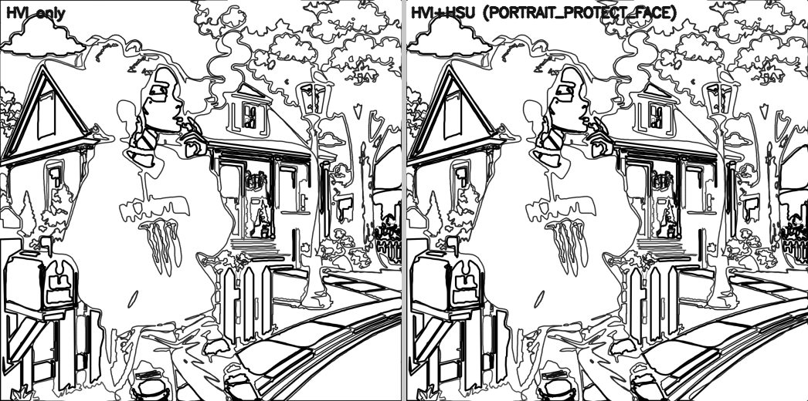
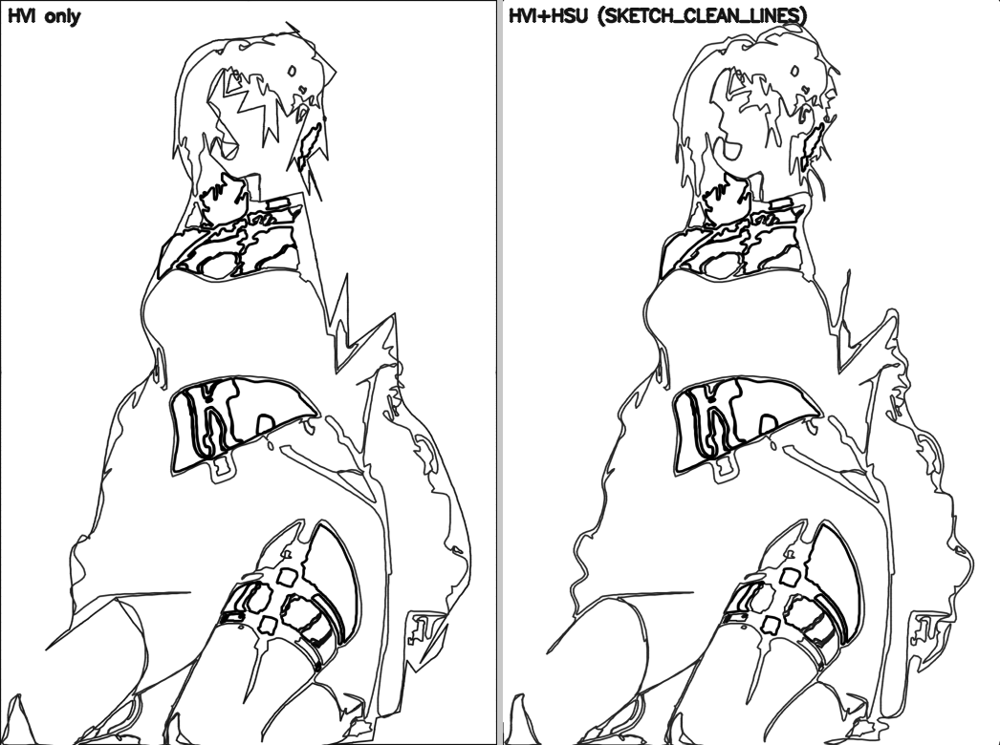
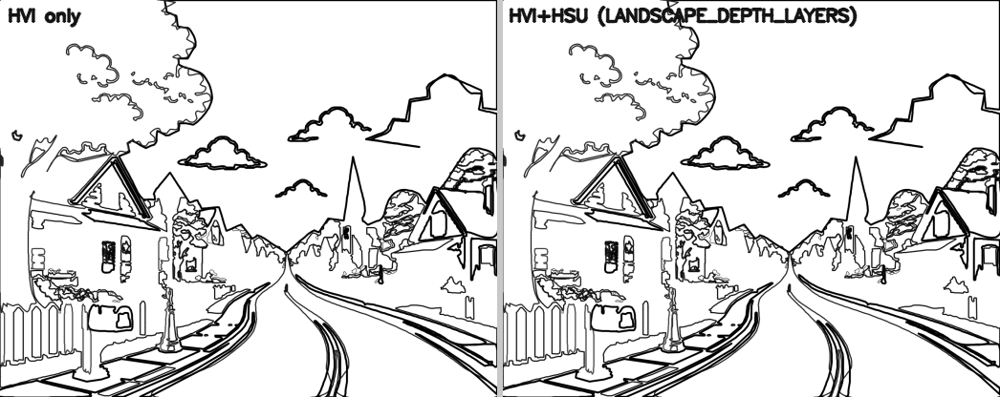

# HSU-Guided Strategy Routing — Report

**Goal.** Use `human_scene_report.json` to guide **safe** processing decisions. The scene's
`recommended_scene_strategy` steers the artistic border rendering per scene type, plus an
**advisory** router/profile hint. It changes no reveal mode, no original image, and no regions
directly — only the border action a segment renders with (on the SVG/vector layer, gated).

Product artifacts change **only** where the scene strategy safely improves the border: the
vector border (`outline.svg` + per-region path geometry). Reveal, masks, labels, palette,
numbering and the numbered preview are untouched.

---

## How the scene strategy routes the border

The pipeline now runs HSU **before** the border render (after HVI). For each segment, after
the region-level HVI guidance, the scene strategy modulates the action by the segment's scene
role (`hsu_strategy_routing.border_action`, a `core.decision` Decision on `hsu_border.action`):

| Strategy | Border behaviour |
|----------|------------------|
| **PORTRAIT_PROTECT_FACE** | protect focal (face) edges from simplification + emphasise them; simplify background |
| **BACKGROUND_SIMPLIFY** | simplify background / low-importance edges; emphasise the subject |
| **SUBJECT_FOCUS** / **OBJECT_CENTERED** | emphasise the main / central subject; simplify background |
| **LANDSCAPE_DEPTH_LAYERS** | emphasise near (subject / foreground); simplify far background |
| **MANDALA_KEEP_SYMMETRY** | never simplify / soften (preserve symmetric detail) |
| **SKETCH_CLEAN_LINES** | no heavy strokes (thicken → keep); declutter background |
| **UNKNOWN_CONSERVATIVE** | no change |

Safety: HSU only touches the SVG layer, is gated by the renderer's shape-fidelity check, and
**never rescues the engine's REMOVE** (a dropped speck is noise, not shape). The
**router/profile start hint** is **advisory** — exposed as `hsu_start_profile_hint_advisory`
in the render report — and deliberately **not** applied, so regions stay identical.

---

## Before / after (HVI only vs HVI + HSU)

Same regions, same numbers, same masks — only the border rendering differs per scene strategy.

### Portrait — protect the face, simplify the background

### Sketch — clean, uniform lines (no heavy silhouette strokes)

### Landscape — emphasise near, simplify far

---

## Validation — all 27 images (`research/08_reports/hsu_routing/hsu_routing_validation.json`)

Rendered each job with HSU routing **off** (HVI only) then **on**.

| Check | Result |
|-------|--------|
| Crashes | **0 / 27** |
| Render accepted (shape-faithful, bounded removal) | **27 / 27** |
| **Reveal completed-image ΔE = 0** | **27 / 27** |
| Region count unchanged | **27 / 27** |
| Per-region numbering unchanged | **27 / 27** |
| Palette unchanged | **27 / 27** |
| Reveal / masks / labels / palette / numbered preview / line art byte-identical | **27 / 27** |
| Outline changed by HSU (where the strategy acts) | **20 / 27** (the 7 UNKNOWN / no-op strategies correctly change nothing) |

**948** border actions were routed by the scene strategy, across every rule:
`emphasize_near 395, simplify_far 211, simplify_background 202, protect_face 72,
clean_lines/declutter 46, keep_symmetry 18, emphasize_face 4`.

Strategy mix on the set: PORTRAIT_PROTECT_FACE 13, LANDSCAPE_DEPTH_LAYERS 5,
UNKNOWN_CONSERVATIVE 4, BACKGROUND_SIMPLIFY 3, MANDALA_KEEP_SYMMETRY 1, SKETCH_CLEAN_LINES 1.

The change lands **only** on the vector border — region count, numbering, palette, reveal,
masks and labels are provably identical, so reveal ΔE stays 0. Confirmed live end-to-end: a
fresh pipeline run emits `human_scene_report.json` before the render, the render reports
`hsu_guided = true` with its strategy, and reveal ΔE = 0.

---

## Files

- `backend/services/hsu_strategy_routing.py` — per-strategy border-action modulation
  (protect / emphasise / simplify by scene role), advisory `start_profile_hint`, `load_plan`.
- `backend/services/artistic_border_renderer.py` — applies HSU after HVI, tracks the
  adjustments, records the advisory router hint; shape-fidelity gate unchanged.
- `backend/pipeline.py` — HSU now runs before the artistic border render.
- Validation + visuals: `research/08_reports/hsu_routing/`.

## Verdict

The engine now understands the scene and routes accordingly: portraits protect the face and
calm the background, landscapes emphasise the near and simplify the far, mandalas keep their
symmetry, sketches stay clean-lined. Every change is on the SVG/vector border only, gated,
and provably free of reveal / region / palette / numbering effects (reveal ΔE = 0 across all
27). The router/profile hint is exposed as advisory, keeping regions stable per the safety
requirement.
