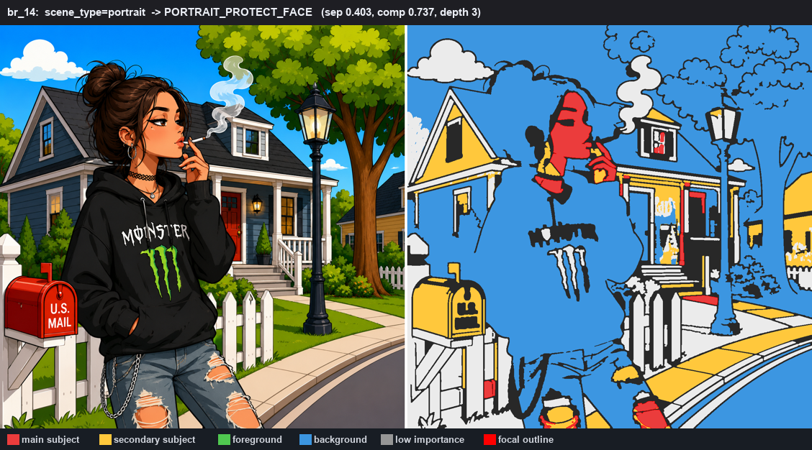
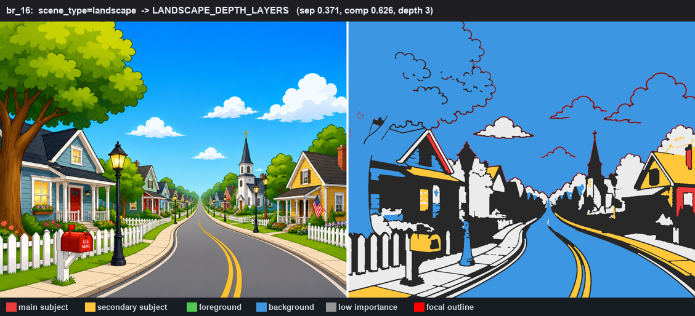

# Human Scene Understanding (HSU) Foundation — Report

**Goal.** Before border decisions, understand the whole image the way a human does — main
subject, background, foreground, focal areas, object relationships, depth, lighting and
composition. **Analysis only.** It reads existing reports and writes exactly one artifact,
`human_scene_report.json`; it changes no border rendering, regions, reveal mode, SVG, palette
or numbering.

This is the scene-level complement to the region-level [HVI Foundation](HUMAN_VISUAL_INTELLIGENCE_REPORT.md).

---

## What it computes (14 fields)

Reading `image_type_report`, `semantic_region_report`, `material_behavior_report`,
`artistic_decision_report`, `human_visual_report` and `review.json`:

| # | Field | Meaning |
|---|-------|---------|
| 1–6 | **main / secondary / background / foreground / focal / low_importance regions** | region label lists, from HVI recognition/attention + artistic role + semantic class + position |
| 7 | **subject_background_separation_score** | recognition + attention gap between subject and background |
| 8 | **composition_score** | clear focal + subject placement + separation + low clutter |
| 9 | **scene_complexity** | review complexity + HVI mean visual complexity + region count |
| 10 | **depth_layers** | distinct depth bands present (background / midground / subject / foreground) |
| 11 | **lighting_direction_estimate** | direction from the dark-region centroid toward the bright one |
| 12 | **eye_flow_direction** | spatial arrangement of the focal / high-attention regions |
| 13 | **scene_type** | image-type router refined by skin / subject signals |
| 14 | **recommended_scene_strategy** | one of the eight strategies below |

**Strategies:** `SUBJECT_FOCUS · BACKGROUND_SIMPLIFY · PORTRAIT_PROTECT_FACE ·
LANDSCAPE_DEPTH_LAYERS · MANDALA_KEEP_SYMMETRY · SKETCH_CLEAN_LINES · OBJECT_CENTERED ·
UNKNOWN_CONSERVATIVE`, chosen by a priority cascade over scene type, face presence, depth,
dominant-subject area and subject/background separation.

Every field is a `core.decision.Decision` (value / reason / confidence / evidence /
override_point / source). The `hsu.*` override points are seam-ready — a future policy can
tune them without changing this module.

---

## The scene, seen

Each region painted by its scene role (red = main subject with focal outline, yellow =
secondary, blue = background), beside the original.

### Portrait — a subject clearly separated from the scene

*The character is isolated as the main subject; the houses / sky / tree fall to background.
scene_type = portrait → `PORTRAIT_PROTECT_FACE`.*

### Landscape — no dominant subject, depth layers

*No single red subject; sky/trees are background, buildings are secondary across depth bands.
scene_type = landscape → `LANDSCAPE_DEPTH_LAYERS`.*

---

## Validation — all 27 images (`research/08_reports/hsu/hsu_validation.json`)

| Check | Result |
|-------|--------|
| Crashes | **0 / 27** |
| Fourteen fields, each a Decision with reason/confidence/evidence/override_point/source | **27 / 27** |
| All override points namespaced `hsu.*` | **27 / 27** |
| `recommended_scene_strategy` in the valid set | **27 / 27** |
| Region-class lists reference only real region labels | **27 / 27** |
| **Only `human_scene_report.json` written** — game_config / labels / outline / masks / reveal / palette / regions / game_preview / HVI report byte-identical | **27 / 27** |
| **Reveal completed-image ΔE = 0** | **27 / 27** |

**No product output changed** — HSU strictly adds its report.

### Scene understanding across the set

- **scene_type:** portrait 13, scene 6, landscape 3, illustration 3, mandala 1, sketch 1
- **recommended_scene_strategy:** PORTRAIT_PROTECT_FACE 13, LANDSCAPE_DEPTH_LAYERS 5,
  UNKNOWN_CONSERVATIVE 4, BACKGROUND_SIMPLIFY 3, MANDALA_KEEP_SYMMETRY 1, SKETCH_CLEAN_LINES 1

Six of the eight strategies are exercised on this (portrait/scene-heavy) set; the cascade
reaches all eight. Example (br_14): `scene_type=portrait → PORTRAIT_PROTECT_FACE`
(separation 0.40, composition 0.74, depth 3) — see `sample_scene_report.json`.

---

## Files

- `backend/services/human_scene_understanding.py` — the HSU engine (region-class lists,
  separation/composition/complexity, depth, lighting, eye-flow, scene type, strategy), each a
  decision-seam Decision.
- `backend/pipeline.py` — `_apply_human_scene`, best-effort after the review pass, in `run()`
  + `reprocess()`.
- Validation + visuals: `research/08_reports/hsu/` (`hsu_validation.json`, `scene_map_14.png`,
  `scene_map_16.png`, `sample_scene_report.json`, `batch_hsu.py`, `make_hsu_viz.py`).

## Verdict

Every image now has a human-style read of the whole scene — who the subject is, what is
background/foreground, where the eye goes, the depth, the lighting, and a recommended
strategy — each explained, confidence-rated and seam-ready. It adds only its report: no
border, region, reveal, SVG, palette or number changes, and reveal ΔE stays 0. This is the
scene-understanding foundation a later sprint can consult to steer border and simplification
decisions per scene type.
