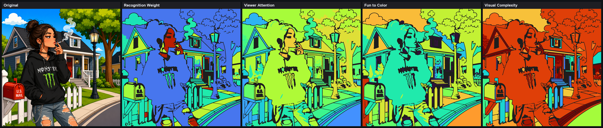

# Human Visual Intelligence (HVI) Foundation — Report

**Goal.** The first visual-reasoning layer. It does **not** generate borders — it only
*understands* visual importance the way a professional coloring-book artist sees an image.
For every region it computes ten perceptual scores and stores them in `human_visual_report.json`.

**Analysis only.** No rendering, no border modification, no reveal modification, no SVG
changes, no region/palette/number changes — it reuses the existing reports and writes exactly
one artifact.

---

## The ten perceptual scores

Each is computed per region from the brain reports and expressed on 0..1:

| Score | What it captures | Driven by |
|-------|------------------|-----------|
| **visual_weight** | how much the region dominates the picture | area, colour pop, centrality |
| **recognition_weight** | how much it identifies the subject | artistic role, visual importance, focal/validation priority |
| **drawing_priority** | what an artist lays down first | structure (silhouette/protected) + recognition + size |
| **tracing_priority** | how carefully the outline must be followed *(a perceptual priority, not tracing)* | recognition + protected shape + boundary detail |
| **beauty_score** | aesthetic appeal | colour harmony, organic elegance, pleasant size, low clutter |
| **fun_to_color_score** | how satisfying it is to fill | comfortable size, clean boundary, part of the subject |
| **visual_complexity** | busy-ness of the region | local boundary complexity, corner density, small-but-detailed |
| **viewer_attention** | where the eye lands (saliency) | centrality, colour pop, recognition, size |
| **memory_importance** | how iconic/memorable | recognition, distinctiveness, attention |
| **artistic_importance** | "an illustrator would guard this" | artistic visual importance, protection flags, focal |

### The artist's eye, visualised (img 14)



Recognition weight lights up the figure (the subject) hot against a cool background; viewer
attention concentrates on her; visual complexity flags the busy foliage and detail. The layer
sees the picture the way a colourist does.

---

## Every score is a future-learning Decision

Each of the ten scores is a `core.decision.Decision` carrying **reason, confidence, evidence,
override_point, source** — so the layer is inspectable today and learnable tomorrow. The
override points are namespaced `hvi.<score>`; they are **seam-ready** — a future experience
policy can override them via `set_policy_provider` with no change here. (The v1 experience
policy whitelists `review.*` only, so today every HVI score is the static rule.)

Inputs used: **Semantic Report** (class, texture, edge flow), **Material Report** (behaviour,
noise), **Artistic Report** (role, visual importance, protection, validation priority),
**Contour Report** (complexity, organic-ness, corners, silhouette), **Review Statistics**
(image-level context), and the **Experience Policy** patterns (surfaced as
`experience_context` and per-region `experience_dominant_reject`; the scores also ride the
same decision seam the policy uses).

Example (a `SUBJECT_CORE` fur region of img 14), abridged — see
`research/08_reports/hvi/sample_region_scores.json`:

```json
"recognition_weight": { "value": 0.92, "confidence": 0.55, "source": "rule",
  "override_point": "hvi.recognition_weight",
  "reason": "identifies the subject: driven by artistic role, visual importance and focal/validation priority",
  "evidence": { "role_base": 0.9, "visual_importance": 0.9, "validation_priority": "CRITICAL" } }
```

---

## Validation — all 27 images

Ran `analyze()` over the 27 finished jobs (`research/08_reports/hvi/hvi_validation.json`).

| Check | Result |
|-------|--------|
| Crashes | **0 / 27** |
| Regions scored | **1461** total; region count matches game_config on **27 / 27** |
| Ten scores per region | **27 / 27** |
| Every score carries reason/confidence/evidence/override_point/source | **27 / 27** |
| All override points namespaced `hvi.*` | **27 / 27** |
| Means present (10 dimensions) | **27 / 27** |
| **Only `human_visual_report.json` written** — game_config / labels / labels_render / outline.svg / region_mask / reveal / palette / regions / game_preview byte-identical before & after | **27 / 27** |
| Perceptual sanity: subject recognition ≥ background recognition | **27 / 27** |

The read-only result is decisive: HVI touches nothing the pipeline produces — it only adds its
report. Image-14 mean scores, for reference:
`visual_weight 0.24, recognition 0.42, drawing 0.51, tracing 0.65, beauty 0.56, fun 0.25,
complexity 0.67, attention 0.42, memory 0.38, artistic 0.53`.

---

## Files

- `backend/services/human_visual_intelligence.py` — the HVI engine (feature extraction, the ten
  scored Decisions, the report).
- `backend/pipeline.py` — `_apply_human_visual` (best-effort, after the review pass) in
  `run()` + `reprocess()`.
- Validation + visuals: `research/08_reports/hvi/` (`hvi_validation.json`, `hvi_scores_14.png`,
  `sample_region_scores.json`, `batch_hvi.py`, `make_hvi_viz.py`).

## Verdict

Every region now has a ten-dimension read of how a coloring-book artist perceives it — each
score explained, confidence-rated, evidence-backed, and seam-ready for future learning — with
zero effect on borders, rendering, reveal, SVG, or regions. This is the visual-intelligence
foundation; consuming these scores in downstream engines is deliberately out of scope here.
