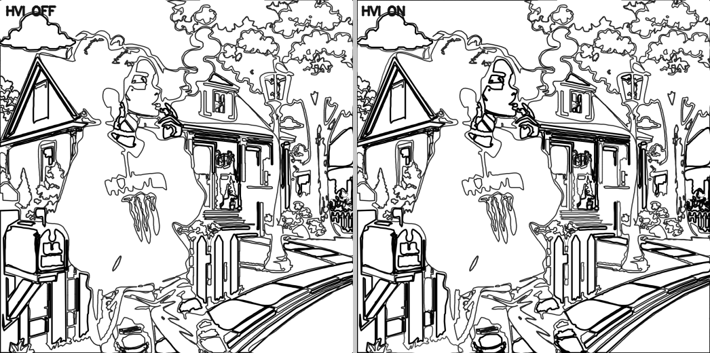
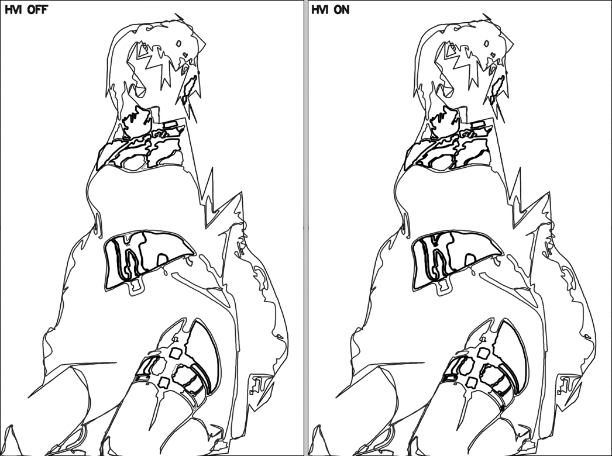

# HVI-Guided Border Decisions — Report

**Goal.** Use `human_visual_report.json` to improve border decisions — let the Human Visual
Intelligence scores steer *which* artistic action each border segment gets. **On the SVG /
vector layer only.** No reveal-mode change, no original-image change, no region-mask change,
no region / palette / number change.

---

## How HVI steers the border

The pipeline now runs HVI **before** the artistic border render, so the renderer can consume
it. For every border segment, its region's ten perceptual scores re-weight the action the
Artistic Border Intelligence decided (`hvi_border_guidance.guide`) — a shape-protecting guard,
then one of emphasis / beauty / declutter:

| HVI signal | Effect on the border |
|------------|----------------------|
| High **recognition / attention / drawing** | stronger, cleaner border → **THICKEN** (silhouette) / **EMPHASIZE** |
| High **beauty** | elegant smooth curve → **SOFTEN** |
| High **fun-to-color** | preserve interesting detail → don't over-**SIMPLIFY** (keep) |
| High **tracing priority** (≥ 0.80) | protect exact shape → don't simplify/soften (keep) |
| Low-importance **background** | soften → **SIMPLIFY** |

Two calibration choices keep it faithful:

- **Protection requires a *genuinely* high tracing score** (≥ 0.80, not the 0.62 "high"
  threshold). HVI's mean tracing sits near 0.65, so a lower bar would guard over half of all
  segments and undo the engine's simplification. Protection is reserved for true signature edges.
- **HVI never undoes the engine's `REMOVE`.** A compact speck the engine dropped is *noise*,
  not shape — the guards only rescue over-*simplification* (SIMPLIFY/SOFTEN), so noise cleanup
  is preserved.

Each adjusted action is a `core.decision.Decision` (`hvi_border.action`) — future-learning
compatible and seam-ready.

---

## Before / after (HVI off vs on)

Same regions, same numbers, same masks — only the border rendering differs. The recognizable
subject gets a stronger, cleaner outline; the engine's background cleanup is preserved.

### img 14 — street scene

### img 06 — figure

The figure / house / mailbox (high recognition) render bolder; background foliage is unchanged.

---

## Validation — all 27 images (`research/08_reports/hvi_border/hvi_border_validation.json`)

Rendered each job with HVI guidance **off** then **on** and compared.

| Check | Result |
|-------|--------|
| Render accepted (shape-faithful, bounded removal) | **27 / 27** |
| **Reveal completed-image ΔE = 0** | **27 / 27** |
| Region count unchanged | **27 / 27** |
| Per-region numbering unchanged | **27 / 27** |
| Palette unchanged | **27 / 27** |
| Reveal masks / region mask / labels byte-identical | **27 / 27** |
| Outline actually changed by HVI | **27 / 27** |

**3830** border actions were HVI-adjusted across the set:
`emphasize_silhouette 2549, emphasize_focal 691, beautify 559, preserve_detail 31`
(protect_shape / declutter fire only in their rare, genuine cases). The change lands **only**
on `outline.svg` + the region path geometry — reveal, masks, labels, palette and numbers are
provably untouched, so reveal ΔE stays 0. The existing shape-fidelity gate still guards every
render (accepted 27/27).

Confirmed live end-to-end: a fresh pipeline run emits `human_visual_report.json` before the
render, the render reports `hvi_guided = true`, and reveal ΔE = 0.

---

## Files

- `backend/services/hvi_border_guidance.py` — HVI-score → adjusted border action (guard +
  emphasis/beauty/declutter), each a decision-seam Decision.
- `backend/services/artistic_border_renderer.py` — loads HVI scores + `is_outer`, re-weights
  each segment's action before rendering, reports the adjustments; quality gate unchanged.
- `backend/pipeline.py` — HVI now runs before the artistic border render (`run()`).
- Validation + visuals: `research/08_reports/hvi_border/`.

## Verdict

HVI now guides the border: recognizable, high-attention, well-drawn regions get stronger,
cleaner outlines; beautiful regions get smoother curves; the engine's noise cleanup and exact
shapes are preserved. All of it lands on the SVG/vector layer alone — reveal ΔE stays 0 and no
region, mask, palette or number changes — with the shape-fidelity gate accepting every image.
