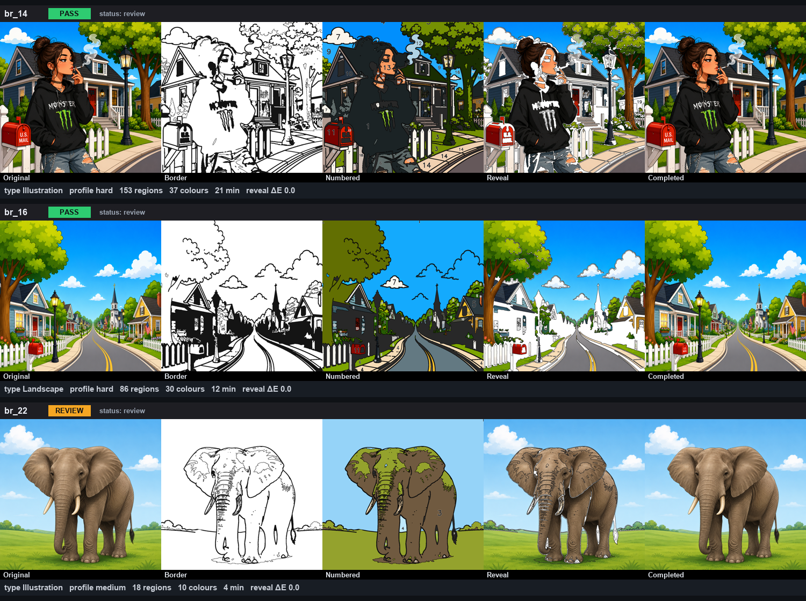

# Local Admin Run & 27-Image Output Review — Report

**Goal.** Run ColorForge AI locally so the admin can visually inspect the real outputs for the
27 test images, with a gallery, per-image stats, a PASS/REVIEW/FAIL verdict, and working
Approve/Reject. No new AI features, no algorithm changes, no Android work — the only code added
is a small read-only **admin gallery** helper (data endpoint + self-contained page).

---

## How it was run

1. **Backend** started locally: `uvicorn main:app --host 127.0.0.1 --port 8000` (health `ok`).
2. **Admin/review UI** is the backend-served, build-free HTML (gallery / publishing / review
   pages) — no separate frontend build needed.
3. **The `test image` folder** (27 PNGs) — reused the already-processed jobs `br_01`…`br_27`
   (each created from the folder in order, with full outputs). The review layer was refreshed
   and each job set to the `review` state (awaiting the admin's decision).
4. The gallery filters to those 27 jobs (`prefix=br_`), non-destructively (the other job dirs in
   `storage/jobs` are left untouched).

---

## The admin gallery

`GET /api/admin/gallery/page` renders one card per image with:

- **five previews** — original · border · numbered · reveal · final completed
- **chosen profile**, **image type**, **region count**, **palette count**, **estimated play time**
- **PASS / REVIEW / FAIL** verdict (FAIL on reveal ΔE≠0 / leaks / not done; REVIEW on a
  needs-attention recommendation, low border quality, or very high complexity; else PASS)
- the current **review status**, **Approve** / **Reject** buttons, and an **Open full review** link

*Representative cards (as the live gallery renders them): two PASS images and one REVIEW
(the simple 18-region elephant), each showing all five previews with reveal ΔE 0.0.*

---

## Exact URLs to open

The backend is running at **`http://127.0.0.1:8000`**.

| Purpose | URL |
|---------|-----|
| **Admin gallery** (open this) | `http://127.0.0.1:8000/api/admin/gallery/page` |
| Gallery data (JSON) | `http://127.0.0.1:8000/api/admin/gallery` |
| **Individual review** (format) | `http://127.0.0.1:8000/api/job/{job_id}/review/page` — e.g. `.../api/job/br_14/review/page` |
| **Package download** (format) | `http://127.0.0.1:8000/api/job/{job_id}/package/download` (build first: `POST .../api/job/{job_id}/package`; requires the image be **approved**) |
| Publishing dashboard | `http://127.0.0.1:8000/api/admin/publishing/page` |
| User catalog (published only) | `http://127.0.0.1:8000/api/catalog/page` |

Job ids for the 27 test images are `br_01` … `br_27` (in the order the folder sorts).

---

## Validation

| Check | Result |
|-------|--------|
| Images visible in the gallery | **27 / 27** |
| Crashes | **0** |
| Reveal completed-image ΔE = 0 | **27 / 27** |
| Five previews resolve (HTTP 200) | verified (original / border / numbered / reveal / completed) |
| Approve / Reject work locally | verified (approve → `approved`, reject+reason → `rejected`) |
| Verdicts | **PASS 24, REVIEW 3** (the 3 REVIEW are the sparsest images — br_08 / br_11 / br_22, 6–18 regions) |
| Image types | Illustration 14, Landscape 6, Portrait 4, Mandala 1, Sketch 1, Anime 1 |
| Code changes | one small read-only gallery helper only (no algorithm change) |

Snapshot: `research/08_reports/local_admin_27/gallery_snapshot.json`; card montage
`gallery_cards.png`; generator `make_gallery_board.py`.

---

## Files

- `backend/main.py` — `GET /api/admin/gallery` (aggregated review data) + `GET
  /api/admin/gallery/page` (self-contained gallery UI). Read-only; reuses the existing review /
  publish asset endpoints for previews and the existing approve/reject endpoints.
- `research/08_reports/local_admin_27/` — snapshot, montage, generator.

## Note on the running server

The backend is left **running in the background** so the URLs above are live. To stop it, end
the `uvicorn` process; to restart: `cd backend && uvicorn main:app --host 127.0.0.1 --port 8000`.
