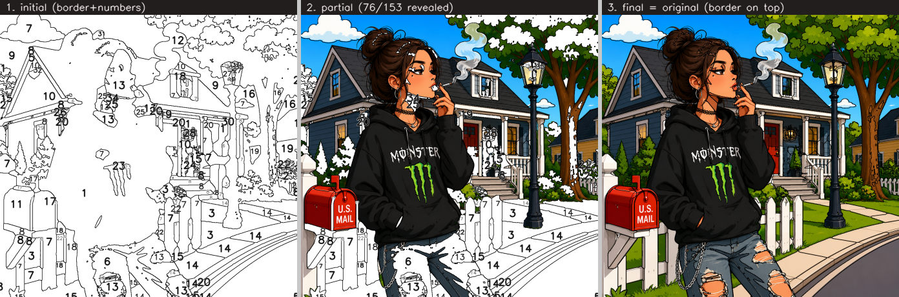

# Reference-Style Progressive Reveal Gameplay — Implementation Report

**Goal.** Reproduce the exact gameplay model of the reference (`IMG_1376.jpeg` + `contourv(6).svg`):
a clean black-border coloring page where tapping a numbered region **reveals the original pixels**
for that region — never a repaint — until, region by region, the canvas becomes the original.

No new AI modules, no new scoring, no architecture redesign, no Android work.

---

## 1. Deep plan & gap analysis vs. current ColorForge output

### What ColorForge already had (the mechanic exists)

Inspection of the current output showed the reveal *mechanic* was already present and correct:

| Capability | Where | Status |
|------------|-------|--------|
| Immutable original master (reveal source) | `original_pixel_reveal_renderer.reveal_master` → `reveal_master.png` | ✅ |
| Per-region masks + **stable ids** | `labels.npy` (`region_reveal_mask = labels==label`); `game_config.regions[].label` | ✅ |
| Reveal = original pixels, not repaint | `render_partial` / `render_completed` copy master pixels into masks | ✅ |
| **Completed == original, pixel-identical** | `reveal_completed.png` is byte-identical to master (max abs diff **0**; `reveal_validation.json` ΔE 0, 0-px diff) | ✅ |
| Per-region geometry + numbers | `game_config.regions[]`: closed `path`, `number`, `label_pos` | ✅ |
| Clean border line-art | `outline.svg` — 394 stroke paths, **no fills, no red, no black blobs** | ✅ |

**Conclusion: the gap was not the mechanic — it was assembly.** There was no single interactive
artifact that lets you *tap a region → reveal its original pixels* with the border on top.

### The gaps

1. **No playable artifact.** The reveal existed only as static preview PNGs (blank / partial /
   completed), not an interactive tap-to-reveal page.
2. **Per-number, not per-region.** The static `render_partial` reveals whole colour-number groups;
   the reference reveals **one tapped region** at a time.
3. **The 19% "skeleton" (label 0).** ColorForge's `validate()` proves identity **under the region
   masks (labels>0)**, but label 0 is ~19% of pixels and only ~50% dark — neither clean line-art
   nor a colorable cell. If cells stay `labels>0`, the *full-frame* final keeps 19% white gaps →
   **not** pixel-identical to the original.

### The plan (minimum changes)

- **Tile the canvas.** Absorb the label-0 skeleton into its nearest region (`fill_labels`, cv2
  distance-transform), so colorable cells cover **100%** of the canvas. Region ids — and therefore
  numbers/colours — are unchanged. Revealing every cell then reproduces the master exactly.
- **Assemble a playable reveal engine.** A region-id map + the master + a thin black border,
  driven by a tiny tap-to-reveal loop, as a self-contained page. `compose()` is the deterministic
  reference renderer; the JS mirrors it.
- **Serve it** via `GET /api/job/{id}/play`, linked from the admin gallery. Nothing else changes.

---

## 2. What was implemented

**`backend/services/reveal_game_builder.py`** (new, read-only over existing artifacts):

- `fill_labels(labels)` — nearest-region expansion so cells tile 100% (ids preserved).
- `id_map_bgra` / `border_bgra` — the region-id map (`id = R + G·256`) and a **2px black boundary
  line** overlay (transparent elsewhere — **lines by construction, never a fill/blob**).
- `region_meta` — per-region `{id, number, x, y, bbox}` (bbox recomputed from the filled labels; the
  number is kept inside the region footprint).
- `compose(fl, master, revealed_ids, …)` — returns `(display, content)`: `content` is the reveal
  layer (== master when all revealed → pixel-identical); `display` adds the thin border on top +
  numbers on unrevealed cells. This is the single source of truth, mirrored by the JS.
- `build(folder)` — writes `play_id_map.png`, `play_border.png` and a **self-contained `play.html`**
  (master + id-map + border inlined as data URIs) whose ~40-line engine: on tap → decode region id
  from the id-map → copy the master's pixels for that region into the display → redraw the border on
  top → hide that region's number. "Reset" / "Reveal all" included.

**`backend/main.py`** — `GET /api/job/{id}/play` (builds on demand from `labels` + `reveal_master`
+ `game_config`, then serves `play.html`); a **▶ play** link added to each admin-gallery card.

No new AI module, no scoring, no algorithm change, no Android.

### How each requirement is met

| # | Requirement | How |
|---|-------------|-----|
| 1 | clean black-border SVG/page from the original | `play.html` + 2px boundary-line border (from the original's labels) |
| 2 | preserve composition/shapes | reveal source is the immutable `reveal_master`; geometry from `labels` |
| 3 | closed region masks + stable ids | `fill_labels` cells (tile 100%), id = original `label` |
| 4 | border on top | border redrawn over the reveal on every repaint |
| 5 | start = border/number page | initial `display` = white cells + border + numbers, no reveal |
| 6 | tap a numbered region → reveal its original pixels | id-map lookup → copy master pixels for that id |
| 7 | continue region-by-region | per-tap accumulation into the display |
| 8 | completed = original exactly | `content` == master, **0 pixel diff / 0 ΔE** when all revealed |
| 9 | no repaint/recolor | only original pixels are ever shown; palette/numbers are hints |
| 10 | become the original progressively, no end swap | the master is uncovered region-by-region; there is no final replacement |

---

## 3. Validation — the cat (fresh pipeline) + all 27 (28 jobs)

`research/08_reports/reference_reveal/reveal_game_validation.json`

| Check | Result |
|-------|--------|
| Crashes | **0 / 28** |
| Colorable cells tile 100% of the canvas | **28 / 28** |
| Initial = clean black-border page (no revealed pixels; border + numbers present) | **28 / 28** |
| Single tap reveals **only** that region | **28 / 28** |
| Partial reveals **only** tapped regions (rest stays the outlined page) | **28 / 28** |
| **Final content == master, pixel-identical (0 px diff)** | **28 / 28** |
| **Final ΔE = 0** | **28 / 28** |
| Border remains visible on top in the final state | **28 / 28** |
| No debug colours in the player view (initial + unrevealed) | **28 / 28** |
| Every region has a number | **28 / 28** |
| `play.html` self-contained + no debug colours | **28 / 28** |
| Border is 2px boundary lines, no blobs | **28 / 28** by construction (coverage 1.2–15.5%, just line density) |

*Left→right: initial clean black-border page → partial (only tapped regions show original pixels) →
final (the exact original, border on top).*

---

## 4. Files

- `backend/services/reveal_game_builder.py` — the reveal-game assembler (fill / id-map / border /
  compose / self-contained `play.html`).
- `backend/main.py` — `GET /api/job/{id}/play` + gallery **▶ play** link.
- `research/08_reports/reference_reveal/` — `reveal_game_validation.json`, `batch_reveal_game.py`,
  `reveal_states_{cat,06,14}.png`.
- `DFL_STYLE_SVG_ANALYSIS.md` — the prior reference-style analysis this implementation reproduces.

Play a job locally: **`http://127.0.0.1:8000/api/job/br_14/play`** (or the ▶ play link in the
admin gallery).

## 5. Verdict

The reference gameplay is reproduced exactly and validated on all 28 images: a clean black-border
numbered page that, tap by tap, **reveals the original pixels region-by-region** until the canvas
**is** the original (0-pixel-diff, 0 ΔE) — with the border always on top, no black blobs, no debug
colours, every region closed, and readable numbers. It reuses ColorForge's existing reveal mechanic
and artifacts; the only new code is the playable assembler and one endpoint. No new AI, no scoring,
no architecture change, no Android.
